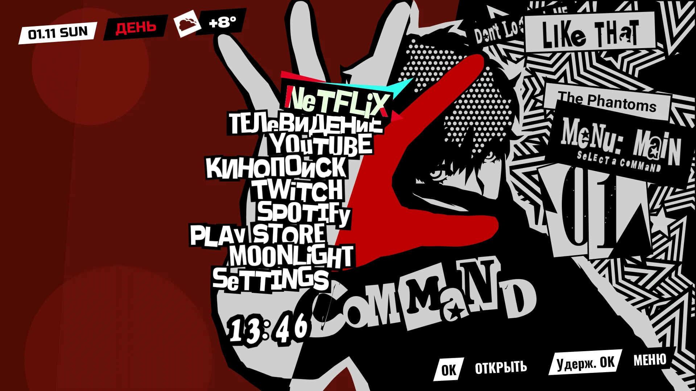
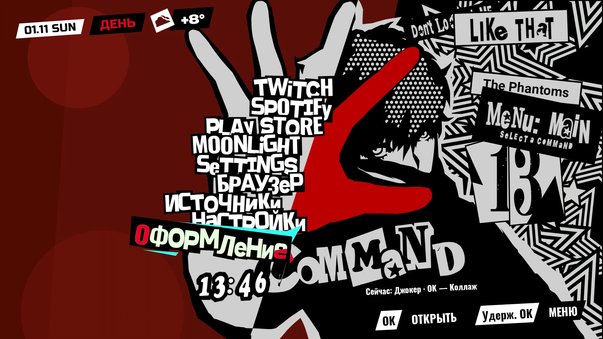
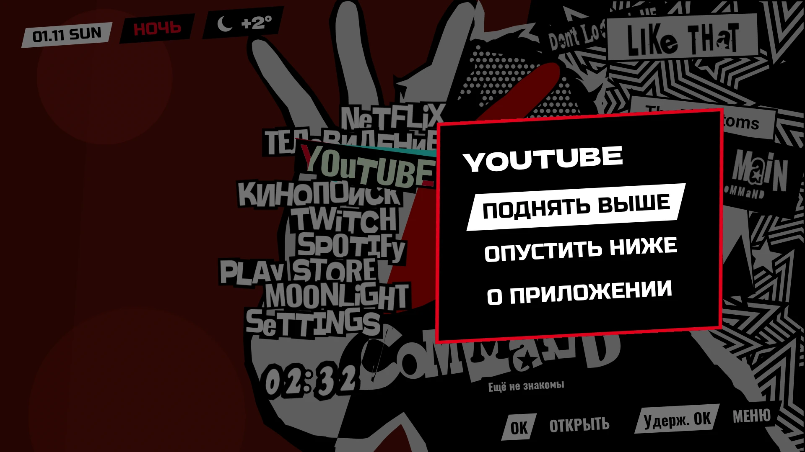
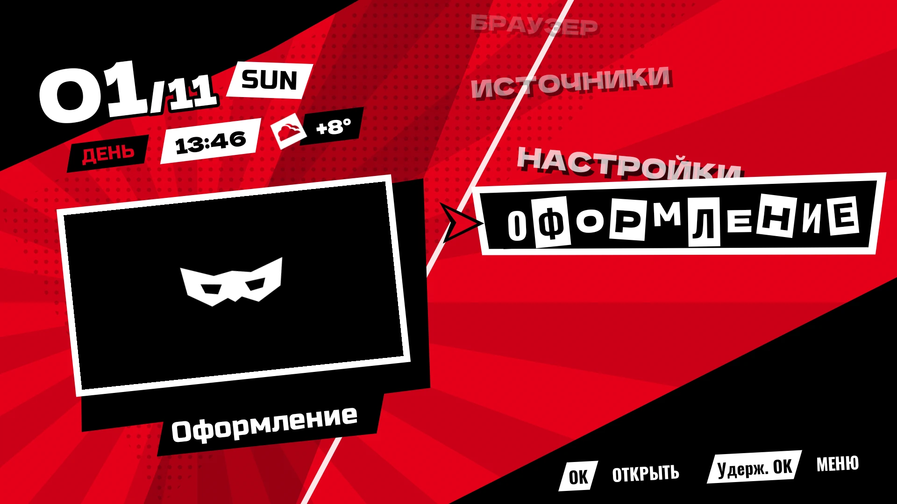

# P5TV

A home screen for Android TV that turns your app list into the pause menu ("camp" menu) of
**Persona 5 Royal**: Joker's hand over his face, the star panel, the ransom-note command list
with its cyan-and-red cursor, the big command number and the money counter as a clock. It
replaces the stock Google TV launcher.



The layout is not drawn from memory. Sprites come from the game's own files, their positions
and scales were found by template matching against an in-game screenshot, and the opening and
cursor animations were timed frame by frame on 60 fps footage of the game.

> Fan project, not affiliated with ATLUS or SEGA. No game assets are in this repository: they
> are extracted from **your own copy** of Persona 5 Royal (Steam) by the scripts in
> [`tools/p5r`](tools/p5r).

## Features

- **Camp menu layout.** Every installed TV app is a command. The selected one is cut out in
  mint letters on a black slab, with the game's cyan wedge and red shards swinging around it.
- **The game's opening.** On every return to the home screen the menu opens like the game's:
  Joker's 3D menu model as flat white and black silhouettes, rendered from the game files, then
  the art cutting in with an impact shake and the words sliding in. Changing the selection pops
  the new command and plays the game's cursor sound.
- **Confidant ranks.** Each app gets an arcana and a rank from 0 to 10, earned by watch time
  over the last 30 days (usage stats). A rank-up shows a «Ранг повышен!» overlay, and the line
  under COMMAND shows the selected app's arcana and rank.
- **Clock, date and weather.** The time is drawn in the money counter's digits. The date, part
  of day and the current weather (Open-Meteo, no API key) sit in the top-left corner.
- **Two themes.** Joker (the camp menu) and Collage (an earlier, freer Persona-style design).
  Switch with the «Оформление» entry at the end of the list.
- **Built for weak TVs.** Static layers are prerendered into bitmaps. Full frame rate runs only
  while something moves; after 2 s without input ambient motion drops to about 25 fps, and
  after 45 s nothing is drawn at all.

| | |
|---|---|
|  |  |
| The list scrolls; the line under COMMAND describes the selected entry | Hold OK (or press Menu) on an app |
|  | |
| The Collage theme | |

The opening, about 3× slower than on the TV:


The UI text is in Russian.

## Controls

| Remote | Action |
|---|---|
| Up / Down | Move the cursor |
| OK | Open the app or shortcut |
| Hold OK, or Menu | App menu: move up, move down, app info |
| Back | Close the app menu (on the home screen itself it does nothing) |
| Home | Back to the first entry |

The fixed entries after the apps: «Источники» (TV inputs), «Настройки» (system settings) and
«Оформление» (next theme).

## Requirements

- An Android TV / Google TV device on Android 11 (API 30) or newer, with network debugging
  (ADB over Wi-Fi) enabled in the developer options. Developed on a Haier TV with Android TV 11,
  an MStar M7322 SoC and about 1.4 GB of RAM.
- Persona 5 Royal for PC (Steam), installed on the build machine.
- Python 3 with [Pillow](https://pypi.org/project/pillow/) and [NumPy](https://numpy.org/).
- Optional, for the opening's silhouettes: [Blender](https://www.blender.org/) 4.2 LTS with the
  [BlenderToolsForGFS](https://github.com/Pherakki/BlenderToolsForGFS) 0.3.1 add-on. Without
  them the opening shows only the backdrop until the art cuts in.
- A JDK (built with OpenJDK 27) and the Android SDK: platform `android-37.0`, build-tools
  `36.1.0` and platform-tools. Gradle 9.8 comes with the wrapper.

## Building and installing

```sh
git clone git@github.com:riclenatin/p5tv.git
cd p5tv
```

Create `local.properties` (it holds per-machine settings and is git-ignored):

```properties
sdk.dir=/path/to/Android/Sdk
# Optional: weather for the top-left corner (here Shibuya). Without these, no weather is shown.
weather.latitude=35.66
weather.longitude=139.70
# The TV for install.sh, as host:port of ADB over Wi-Fi.
tv.address=192.168.1.20:5555
```

Extract the menu's sprites and sounds from the game:

```sh
python3 tools/p5r/make_assets.py   # pass your P5R folder if it is not in the default Steam library
```

Optionally render Joker's model for the opening (`SCRIPTS` is a folder whose `addons/` holds
BlenderToolsForGFS):

```sh
P5R=~/.local/share/Steam/steamapps/common/P5R
python3 tools/p5r/cpk.py "$P5R/CPK/BASE.CPK" extract INIT/MENU_C0001_001_A.GMD INIT/MENU_C0001_001_A.GAP build/p5r
BLENDER_USER_SCRIPTS=SCRIPTS blender -b --factory-startup --python tools/p5r/opening/render.py -- \
    --gmd build/p5r/INIT/MENU_C0001_001_A.GMD --gap build/p5r/INIT/MENU_C0001_001_A.GAP \
    --params tools/p5r/opening/params.json --out build/p5r/frames
python3 tools/p5r/opening/pack.py build/p5r/frames
```

Build and install:

```sh
./gradlew assembleRelease   # the first build downloads dependencies
./install.sh
```

`install.sh` installs the release APK, compiles it ahead of time (Compose stutters on a slow SoC
otherwise), grants usage access for the ranks, makes the app the HOME activity and disables the
stock launcher. The stock launcher's HOME filter has a higher priority than any third-party app can
get, so disabling it is the only way to switch without root. `./install.sh --restore` enables it
again; this app stays installed.

The release build is signed with your local debug key, so later installs upgrade in place.

## How it works

```
app/src/main/kotlin/com/chroniac/tvhome/
├── HomeActivity.kt       app list, shortcuts, theme choice, lifecycle
├── Entries.kt            installed leanback apps and their saved order
├── Bonds.kt              confidant ranks from UsageStatsManager
├── Weather.kt            Open-Meteo current weather, cached
├── MenuSounds.kt         the game's cursor and menu-open sounds (SoundPool)
└── ui/
    ├── LauncherScreen.kt frame clock, idle throttling, remote keys
    ├── Phantom.kt        the Joker theme: the camp menu
    ├── Opening.kt        opening and cursor timings measured on the footage, frame by frame
    ├── OpeningFrames.kt  the opening's silhouettes, loaded as alpha masks
    ├── Ransom.kt         ransom-note lettering
    ├── Motion.kt         selection state and easing on a frame clock
    └── …                 Collage theme, app menu, rank-up overlay, date badge
tools/p5r/
├── make_assets.py        writes res/drawable-nodpi/p5_* and res/raw/p5_* from the game
├── cpk.py                CRI CPK archives: TOC, CRILAYLA, P5R's per-file XOR
├── spd.py                Atlus SPD sprite dictionaries (lists sprite ids when run directly)
├── sfx.py                the SYSTEM.ACB/AWB sound bank: CRI ADX with P5R's key
└── opening/
    ├── render.py         Blender: Joker's menu model, one image per opening frame
    ├── params.json       per frame: animation time, camera, star-panel edge
    └── pack.py           rendered frames → alpha masks in assets/p5_opening
```

The opening's silhouettes are Joker's camp-menu model (`INIT/MENU_C0001_001_A.GMD`) playing
animation 0 of its GAP pack, drawn flat: white left of the star panel's edge, black over it. The
game files hold no camera for this shot, so the cameras in `params.json` were fitted to the
footage frame by frame. The app keeps the 36 masks as half-resolution ALPHA_8 bitmaps, about
5 MB.

All motion runs on one frame clock instead of Compose animations. Slow TVs are often sped up by
setting the animator duration scale to 0 (the author's is), and that would make every Compose
animation jump straight to its end.

## Credits

- P5R's CPK encryption: [CriFsV2Lib](https://github.com/Sewer56/CriFsV2Lib) (algorithm credited
  there to Lipsum and Zarroboogs).
- SPD sprite format: [PersonaSpriteTools](https://github.com/Secre-C/PersonaSpriteTools).
- ADX decoding and P5R's key: [vgmstream](https://github.com/vgmstream/vgmstream).
- GMD model and GAP animation import: [BlenderToolsForGFS](https://github.com/Pherakki/BlenderToolsForGFS).
- Weather: [Open-Meteo](https://open-meteo.com/).
- Fonts: Dela Gothic One, Russo One and Oswald under the SIL Open Font License 1.1; license
  texts in [`third_party/fonts`](third_party/fonts).

Persona 5 Royal and all of its characters, artwork and sounds are © ATLUS / SEGA.
